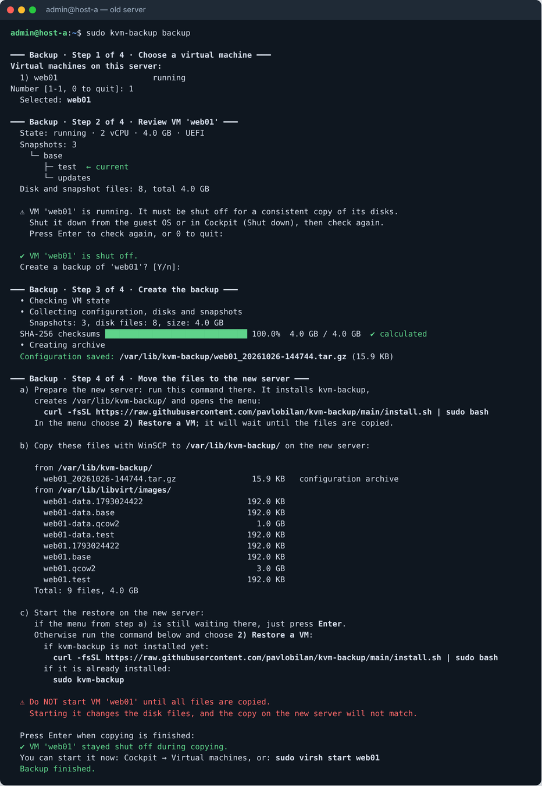
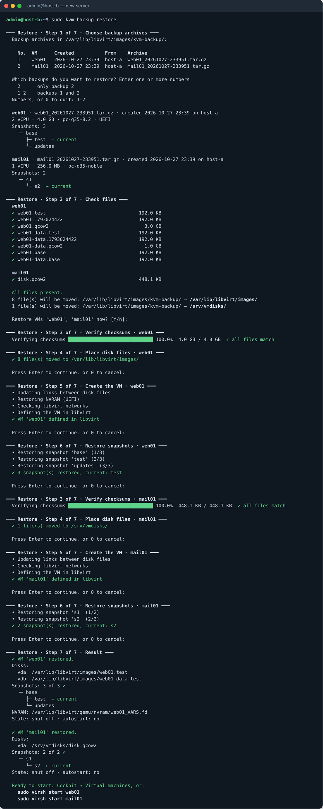
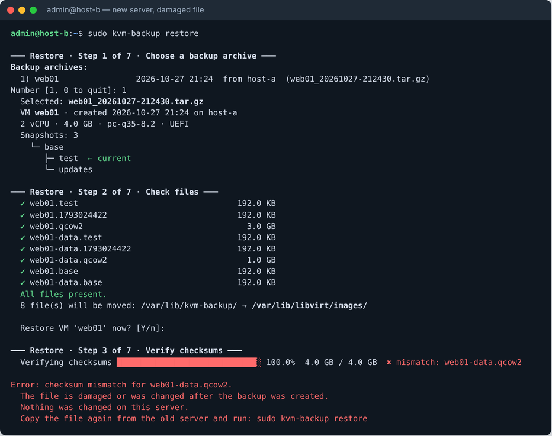

# kvm-backup

Full backup and migration of KVM/libvirt virtual machines between Debian servers: configuration, disks and the whole snapshot tree, including branches. Runs in the terminal and depends only on the Python 3 standard library, `virsh` and `qemu-img` (no Cockpit, no Debian Python packages).

## Install (on both servers)

Run all commands on the KVM host (the Debian server running libvirt), not inside a virtual machine.

Install `curl` first (minimal Debian does not include it):

```
sudo apt install -y curl
```

Then install kvm-backup:

```
curl -fsSL https://raw.githubusercontent.com/pavlobilan/kvm-backup/main/install.sh | sudo bash
```

When the installation finishes, the interactive menu opens automatically: choose **1) Back up VMs** or **2) Restore VMs**. No separate command is needed after installing. Every stage is shown as a numbered step and asks only when a choice is needed.

The user who runs `sudo` is added to the `kvmbackup` group, which lets WinSCP read and write the needed files without root (takes effect after the next login).

## Run again (already installed)

```
sudo kvm-backup
```

This opens the same menu. To skip the menu:

```
sudo kvm-backup backup
sudo kvm-backup restore
```

Running the install command again updates kvm-backup to the latest version and also opens the menu.

## Back up (old server)

1. **Choose virtual machines:** one or several, for example `2`, `1 3` or a range `1-3`.
2. **Review the VMs** (state, snapshot tree, disk files). A running VM is never shut down by the tool: it asks you to shut it down and checks again.
3. **Create the backups.** A SHA-256 checksum of every disk and snapshot file is calculated, and the configuration of each VM is saved to its own archive: `/var/lib/libvirt/images/kvm-backup/<VM>_<date>.tar.gz`. Backups are independent of each other.
4. **Copy the files to the new server.** The tool shows the commands that install kvm-backup on the new server (`sudo apt install -y curl`, then the install command; this creates the target directory), every file to copy with its source directory and the target directory (`/var/lib/libvirt/images/kvm-backup/`). Copy them with WinSCP while the VMs stay shut off; after Enter, temporary read access is removed and the tool reports whether the VMs stayed off.

## Restore (new server)

Each step shows its result; the next one starts after you confirm with Enter. Entering 0 cancels the restore and rolls back the changes made for the VM being restored. Steps 3–6 run for each selected VM in turn.

1. **Choose backup archives** from `/var/lib/libvirt/images/kvm-backup/`: one or several (one per VM), the same way as on the old server. The tool waits if nothing has been copied yet.
2. **Check files.** Every file listed in the archive is checked for presence and size; missing files are listed and the check can be repeated after copying them.
3. **Verify checksums.** If all files match, the restore goes on to step 4 without asking; on a mismatch it stops before anything is changed.
4. **Place disk files** at their original paths.
5. **Create the VM** in libvirt (links between disk files, NVRAM, networks, storage pool).
6. **Restore snapshots**, including branches and the current snapshot.
7. **Result:** disks, snapshot tree, current snapshot, VM state. The VM appears in Cockpit, ready to start.

## Where the files go

On both servers kvm-backup uses one folder: `/var/lib/libvirt/images/kvm-backup/`.

- Old server: the configuration archives are saved there.
- New server: the archives **and** the disk files are copied there with WinSCP. The restore checks them and then moves the disks to their original paths (for example `/var/lib/libvirt/images/`).

The folder is inside the default libvirt storage folder on purpose: the copied disks are on the same disk as the restored VMs, so moving them into place takes no time and no extra space. Cockpit shows it as a volume `kvm-backup` in the storage pool of `/var/lib/libvirt/images` (usually named `default`).

The step that lists the files to copy shows the total size; the new server needs at least that much free space in this folder.

## Checksums

- During backup, the SHA-256 checksum and size of every disk and snapshot file are stored in `manifest.json` inside the archive.
- During restore, every file is checked for presence and size, then its SHA-256 is compared with the archive. On a mismatch the restore stops before anything is changed on the server.
- Not covered by a separate checksum: ISO images (optional), the configuration archive itself (protected only by the gzip integrity check) and the result of copying disks between different file systems on the new server.

## Screenshots

Backup on the old server:



Restore on the new server:



Restore stopped because a copied file is damaged:



## Limitations

- Only file-based disks (qcow2, raw) are migrated; block devices (LVM) are reported and skipped.
- Network bridges (`br0` etc.) must exist on the new server.
- Snapshots with saved memory may fail to revert on a host with a different CPU or a much older QEMU.

## Uninstall

```
sudo /opt/kvm-backup/uninstall.sh
```
